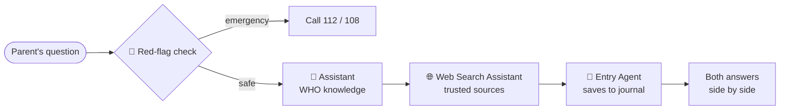

<div align="center">

# 👶 ParentPal

**A 2 a.m. helpdesk for parents: WHO guidance and trusted web answers, side by side.**

   

</div>

> 💗 General information only, **not medical advice**. Always follow your paediatrician.

## 🧠 How it works



| Agent | Role |
|---|---|
| 🧠 **Assistant** | Answers from **[WHO (who.int)](https://www.who.int/)** guidance on feeding, vaccines, sleep and illness |
| 🌐 **Web Search Assistant** | Searches trusted web sources (UNICEF, health services) and cites them |
| 📔 **Entry Agent** | Saves the question and both answers to `baby_journal.txt` |

## ✨ Highlights

- 🚨 **Emergency check**: danger words skip the AI and show a tap-to-call card
- ⚡ **Live agent tracker**: watch each agent work in real time
- 🧸 **Age-aware**: answers fit your child's age and country
- 🩺 **Doctor-visit sheet**: one click turns your journal into a printable question list
- 💰 **Low token use**: only relevant WHO sections are sent, and repeated questions cost 0 tokens
- 🔐 **Keys stay safe** in `.env`, never in code or Git

## 🚀 Quick start

```bash
cd "CrewAI - Parent Pal"
python3 -m venv venv && source venv/bin/activate
pip install -r requirements.txt
cp .env.example .env        # add OPENAI_API_KEY and SERPER_API_KEY
python3 server.py           # open http://localhost:8000
```

## 📁 Files

| File | Purpose |
|---|---|
| `server.py` | FastAPI server (run this) |
| `crew.py` | CrewAI agents, tools and WHO knowledge |
| `index.html` | React UI, kept next to `server.py` |
| `app.py` | Optional Streamlit version: `streamlit run app.py` |

---

<div align="center">Built for the <b>Gen AI Architect Weekly Buildathon</b> · CrewAI · React · WHO</div>
